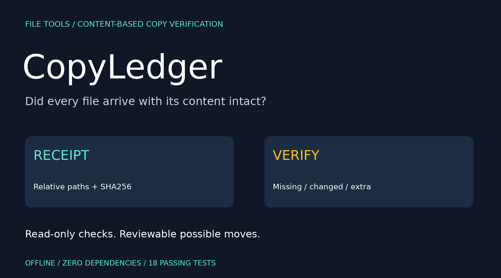
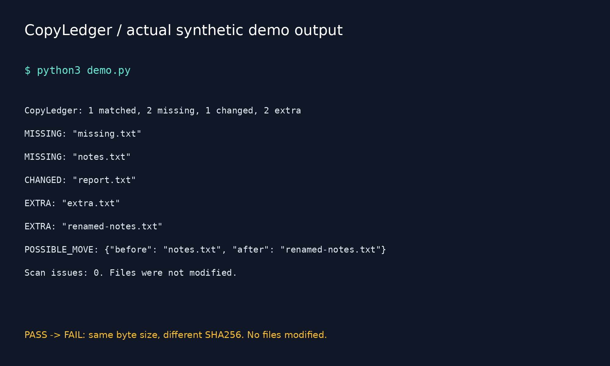

# CopyLedger



  

**A content receipt for your next folder copy.**

CopyLedger creates a SHA256 receipt for regular files in one folder, then verifies another folder against it. It reports missing, changed and extra files, and suggests possible moves when exactly one missing and one extra file share a size and digest.

It reads bytes instead of trusting filenames, file sizes or modified dates. It does not copy, move, delete, repair or modify source files. All reports and receipts use relative file paths; no absolute root directory is stored in them.

## Who it helps

Check a project handoff, USB transfer, backup copy or folder migration before discarding your source. It is a small verification utility, not backup software, a filesystem snapshot engine, a signature system or a new integrity-checking category. Keep a real backup and retain the source until you have reviewed the result.

## Quick start

Python 3.10+; no pip packages required. Download or clone this repository, open its directory:

```bash
python3 copyledger.py receipt /path/to/source --output receipt.json
python3 copyledger.py verify receipt.json /path/to/copied-folder
python3 copyledger.py verify receipt.json /path/to/copied-folder --html review.html
python3 copyledger.py verify receipt.json /path/to/copied-folder --json > report.json
python3 -m unittest discover -v
```

On Windows, use `py -3` if necessary and quote paths containing spaces. Receipts and HTML outputs must be **outside the folder being scanned**, with new filenames. Existing outputs and symlinks are refused through exclusive creation. The JSON stdout redirection above is performed by your shell; choose a safe path outside the scanned folder and note that shell redirection can overwrite an existing file.

## Reproducible synthetic demo

```bash
python3 demo.py
python3 demo.py --html review.html
python3 demo.py --json
```

`demo.py` creates temporary source/copy folders with deliberate mistakes, runs the real CLI, and cleans up its temporary files. The report includes no actual user files.

Actual output:

```text
CopyLedger: 1 matched, 2 missing, 1 changed, 2 extra
MISSING: "missing.txt"
MISSING: "notes.txt"
CHANGED: "report.txt"
EXTRA: "extra.txt"
EXTRA: "renamed-notes.txt"
POSSIBLE_MOVE: {"before": "notes.txt", "after": "renamed-notes.txt"}
Scan issues: 0. Files were not modified.
```

In this example, `report.txt` changes from four bytes `PASS` to four bytes `FAIL`; the size stays the same, but the hash changes. `notes.txt` has the same content at a new path, so a possible move is suggested. It still counts as missing/extra because a path-preserving copy did not match exactly.

Included [HTML review](examples/review.html) and [JSON result](examples/report.json) are generated from this demo. Download HTML to view it locally.

## Receipt format

```json
{
  "format": "copyledger-v1",
  "algorithm": "sha256",
  "files": [
    {
      "path": "empty.txt",
      "bytes": 0,
      "sha256": "e3b0c44298fc1c149afbf4c8996fb92427ae41e4649b934ca495991b7852b855"
    }
  ]
}
```

The CLI validates exact schema fields, canonical relative paths, nonnegative integer sizes, lowercase SHA256 digests and duplicate entries. Absolute paths, traversal components, backslashes and colons in receipt file paths are rejected. This deliberately favors portable receipt paths over support for every legal Unix filename. Unicode names are preserved without normalization; case is significant.

## Results and exit codes

| Result | Meaning |
| --- | --- |
| `matched` | Same relative path, size and SHA256 |
| `missing` | Receipt path absent from readable regular files |
| `changed` | Same path with different size or digest |
| `extra` | Readable regular file absent from receipt |
| `possible_moves` | One-to-one missing/extra content match; suggestion only |
| `scan_issues` | Entries that could not be verified safely/fully |

Duplicate-content groups with multiple missing or extra candidates do not get a move suggestion. A suggestion does not prove a rename occurred. Matching and scan order are deterministic. No automatic rename or deduplication is performed.

| Exit | Meaning |
| --- | --- |
| 0 | Receipt created successfully, or target matches exactly |
| 1 | Verification completed and found content/path differences |
| 2 | Invalid receipt, incomplete scan, unsupported/unreadable entry or I/O failure |

`demo.py` returns 0 when its deliberately mismatched example is detected as expected. The underlying `verify` command returns 1 for that example.

## Scan behavior

- Regular files, including hidden files, are hashed in 1 MiB chunks; per-file content is not retained in memory.
- Symlink files/directories are not followed. A root that is itself a symlink is refused.
- Any unsupported/unreadable/linked/changing entry prevents receipt creation. Verification records such issues and returns 2, so incomplete scans cannot appear successful.
- Directory enumeration failures abort the scan. File identity/size/time metadata is compared before and after hashing to catch common concurrent changes.
- Empty directories, permissions, ownership, timestamps, extended attributes and resource forks are not represented.
- Receipts and reports contain relative filenames, byte sizes and digests, but no file contents. Names/hashes may still be sensitive; review before sharing.

## Limits and interpretation

Use stable folders. This is not an atomic snapshot and does not defend against an adversary racing filesystem changes or replacing parent directories during the scan. OS/filesystem-specific junction/reparse behavior is not comprehensively handled. Hard-linked files are represented once per path, with no link-topology preservation.

SHA256 receipts detect byte differences against the receipt you supply; they are not signed or authenticated. If someone changes both files and receipt, this tool cannot establish trust. Keep receipts separately if that matters. Reading may update access times under your filesystem settings. Existing output files are never overwritten by the program, but a write failure may leave a partial new report/receipt.

The file list and reports are held in memory. All file bytes are read for each scan, so runtime depends on total data size and storage speed. It does not inspect archives, compare remote drives through APIs, verify block-level storage health, repair errors or guarantee recovery.

## Validation

18 standard-library tests cover exact matches, same-size content corruption, missing/extra files, possible moves, ambiguous duplicate-content groups, nested Unicode paths, empty-file digests, file/directory/root symlink handling, invalid/traversal paths, duplicate manifest paths, malformed digests, invalid sizes, overwrite refusal, output-inside-root refusal, HTML escaping and CLI exit behavior.

## Launch kit



[Arabic and English launch drafts](POST.md).

Suggested topics: `file-integrity`, `backup-verification`, `sha256`, `python`, `cli`, `offline`, `developer-tools`, `file-management`.

Search phrases: verify folder copy, SHA256 folder receipt, detect missing backup files, compare copied folder content.
